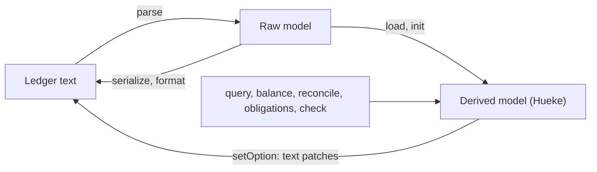
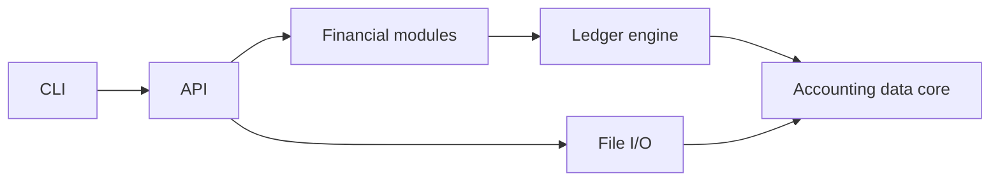

# Architecture

What the Hueke package provides, how Core is split into modules and which way they depend on each other, how the Raw model and the derived model relate, where each module lives in the source tree, which document drives which code and tests, and the rules every public function follows.

## Package

Hueke is published as one package, `@hueke/hueke`, with two entry points built from the same source and released under the same version.

| Entry point | Built file | For | Described in |
| --- | --- | --- | --- |
| The `hueke` command | `dist/cli/main.js`, the package's `bin` | People working with ledger files: load, check, query and reconcile from a terminal | [cli.md](cli.md) |
| The library (Core) | `dist/index.js` with type declarations, the package's main export (`@hueke/hueke`) | Platforms that read and write ledger text themselves, such as an editor plugin or a web page | The topic documents, "API" sections; "Public API rules" below |

- Besides the library, the package exports `assets/` as files, as `@hueke/hueke/assets/<file>`: Hueke's icon (`hueke.svg`), for platforms that show it.
- The command uses only the library's public API (see "Dependency direction").
- The package's dependencies are the library's. The command adds no runtime dependency of its own beyond Node.

## Data flow

- **Raw model**: what one file says, as written. **Derived model**: what initialization builds from the Raw models of one ledger. Both are defined in [core/ledger.md](core/ledger.md), "Concepts".
- **Serialization** turns Raw records back into ledger text in the canonical form (see [dsl/formatting.md](dsl/formatting.md)).
- **Text patches** are how Core changes ledger text: changes to a module's text, for the platform to apply (see [core/ledger.md](core/ledger.md), "Text patches").

## Runtime constraints

1. Core is a pure TypeScript library. It uses no platform-specific API and does no I/O. The CLI is a platform built on the API, not part of Core; it is the only code that uses Node APIs.
2. Core never sees files. One file is one module, identified by a logical path that the platform chooses. Reading and writing files is the platform's job (CLI, editor plugin, web page).
3. Amounts use exact decimal arithmetic, serialized as strings. Floating-point numbers are never used for money.
4. Time zone conversion uses IANA time zone data.
5. Every model can be represented as JSON; amounts and times are strings.
6. Core targets ES2022 and its standard library only, without DOM or Node types, so it runs in current browsers, in Obsidian and in Node 22.12 or later.

## Modules

| Module | Responsibility |
| --- | --- |
| Accounting data core | Value types and records: numbers and commodities, time, the Raw model, the derived model, the account hierarchy, the values each ledger setting accepts, logical paths and their resolution, text patches, diagnostic codes and their severities. No rules that need the whole ledger. |
| Ledger engine | Loading and normalization, anchors and tags, validation, queries, `balance`, Balance assertions and `pad`, the reconciliation view. |
| Financial modules | Views derived after loading that are not plain queries: the progress of obligations and of refunds. |
| File I/O | String conversion only: the parser (text to Raw model), serialization and formatting (Raw model to text; formatting a module is a draft), and the text patches that change a setting. Never reads or writes files. |
| API | The only entry point. It combines the modules and adds no rules of its own. |
| CLI | The `hueke` command: reads ledger files, calls the API and prints the result (see [cli.md](cli.md)). |

### Dependency direction

- An arrow points at the module depended on. Reverse dependencies are not allowed.
- The accounting data core depends on nothing else.
- The ledger engine does not know the DSL: its input is parsed Raw records.
- File I/O depends on the accounting data core only. Serialization, formatting and changing a setting need the ledger's settings, commodities and Raw models; they read them from the initialized ledger as plain data-core values and call no engine code.
- Which values a setting accepts is in the data core, because both the engine (reading settings) and File I/O (refusing a value when changing a setting) apply it.
- Path resolution is in the data core, not in File I/O, because the engine resolves `include` during initialization.
- The CLI uses only the public API. Linting rejects Node imports and globals everywhere else.
- When the CLI needs a rule the engine already has, such as which time a posting has on an axis (`timeOnAxis`), the rule is exported from the API, not copied into the CLI.
- Expansions that change the recorded postings (such as `pad`) run at load time and belong to the engine. Derivations made only at query time and never stored belong to the financial modules.
- Diagnostic codes and their severities live in the data core, because both the parser and the engine report them. Every code, from either, has its severity there.

## Source layout

Each subdirectory of `srcs/` is one module. Unit tests in `tests/` mirror `srcs/`. Acceptance tests that run whole ledgers live in `tests/cases/`, one file per topic document.

| Directory | Module | Contents |
| --- | --- | --- |
| `srcs/index.ts` | API | Public exports; no rules of its own |
| `srcs/data/values/` | Accounting data core | Identifiers, decimals and amounts; exact decimal arithmetic; reading numbers, expressions and amounts as written |
| `srcs/data/time/` | Accounting data core | Time values and axes; reading time text, with the rules shared by the parser and the API's time arguments; weeks; time predicates |
| `srcs/data/source/` | Accounting data core | Logical paths and `resolvePath`; source spans and `position`; text patches; diagnostics, diagnostic codes and their severities |
| `srcs/data/raw/` | Accounting data core | Raw model, anchor keys, `referencedSources` |
| `srcs/data/model/` | Accounting data core | Derived model, the account hierarchy, `timeOnAxis`, text order, the values each ledger setting accepts |
| `srcs/engine/hueke.ts` | Ledger engine | `Hueke` (`load`, `init`, its options) and `check` |
| `srcs/engine/normalize/` | Ledger engine | One file per normalization step, in order: unsupported syntax, modules (include order and `module.*`), declarations, records, anchors and tags, `pad` expansion, validation; plus one file of helpers the steps share, which the query code and the financial modules also use |
| `srcs/engine/query/` | Ledger engine | Query filters, grouping, the account tree, `balance` and `register` with settled obligations left out, `reconcile` |
| `srcs/finance/` | Financial modules | `obligations`, `refunds` |
| `srcs/io/parser/` | File I/O | ANTLR grammar, hand-written lexer, error recovery, `parse` |
| `srcs/io/format/` | File I/O | `serialize`; `setOption`; `format`, a draft |
| `srcs/cli/` | CLI | `main.ts` (the `hueke` binary); argument handling and loading, including following `referencedSources`; one file per subcommand; output formats |

- `srcs/io/parser/generated/` is generated from `Hueke.g4` by `pnpm generate` and not committed. `prepare` (run by `pnpm install`), `typecheck`, `test` and `lint` run `generate` first.
- `pnpm build` compiles `srcs/` to `dist/` (not committed), with type declarations. The built entry points are listed under "Package".
- Within the data core, `values/` and `time/` import nothing else in it. `source/` may import those two, `raw/` may import those three, and `model/` may import all four. A lower layer never imports a higher one; linting rejects such an import.
- Helpers used by more than one normalization step are in their own file, not inside one of the steps. The query code and the financial modules may import that file too, for the same rules (such as the refund measure and the tolerance).

## Documents, code and tests

Each document drives the code and tests listed here. When a document changes, these are the places to update.

| Document | Code | Acceptance tests |
| --- | --- | --- |
| [core/values.md](core/values.md) | `srcs/data/values/`, `srcs/engine/normalize/records.ts` | `tests/cases/values.test.ts` |
| [core/commodities.md](core/commodities.md) | `srcs/data/model/`, `srcs/data/values/number.ts` (aliases), `srcs/engine/normalize/declarations.ts`, `srcs/engine/normalize/validate.ts`, `srcs/engine/hueke.ts` | `tests/cases/commodities.test.ts` |
| [core/time.md](core/time.md) | `srcs/data/time/`, `srcs/engine/normalize/declarations.ts`, `srcs/engine/normalize/records.ts` | `tests/cases/time.test.ts`, `tests/data/time/time.test.ts` |
| [core/accounts.md](core/accounts.md) | `srcs/data/model/`, `srcs/engine/normalize/declarations.ts`, `srcs/engine/hueke.ts` | `tests/cases/accounts.test.ts` |
| [core/anchors.md](core/anchors.md) | `srcs/data/raw/` (anchor keys), `srcs/engine/normalize/anchors.ts`, `srcs/engine/normalize/shared.ts` and `validate.ts` (refunds), `srcs/engine/query/` (`ids`), `srcs/finance/` (`refunds`) | `tests/cases/anchors.test.ts` |
| [core/entities.md](core/entities.md) | `srcs/data/model/`, `srcs/engine/normalize/declarations.ts`, `srcs/engine/normalize/records.ts` | `tests/cases/entities.test.ts` |
| [core/obligations.md](core/obligations.md) | `srcs/engine/normalize/declarations.ts` (inheritance), `srcs/engine/normalize/pad.ts`, `srcs/engine/normalize/validate.ts`, `srcs/engine/query/` (settled obligations), `srcs/finance/` | `tests/cases/obligations.test.ts` |
| [core/transactions.md](core/transactions.md) | `srcs/data/model/`, `srcs/engine/normalize/records.ts`, `srcs/engine/normalize/validate.ts` | `tests/cases/transactions.test.ts` |
| [core/balance.md](core/balance.md) | `srcs/engine/normalize/pad.ts`, `srcs/engine/normalize/validate.ts`, `srcs/engine/query/reconcile.ts` | `tests/cases/balance.test.ts` |
| [core/query.md](core/query.md) | `srcs/engine/query/`, `srcs/data/time/` (predicates) | `tests/cases/query.test.ts` |
| [core/ledger.md](core/ledger.md) | `srcs/engine/hueke.ts`, `srcs/engine/normalize/`, `srcs/data/source/` (source positions, text patches), `srcs/io/parser/` (the module's text) | `tests/cases/ledger.test.ts`, `tests/data/source/source.test.ts` |
| [core/modules.md](core/modules.md) | `srcs/engine/normalize/modules.ts`, `srcs/data/source/` (paths), `srcs/data/raw/` (`referencedSources`) | `tests/cases/modules.test.ts`, `tests/data/source/paths.test.ts`, `tests/data/raw/include.test.ts` |
| [core/settings.md](core/settings.md) | `srcs/data/model/` (setting values), `srcs/engine/normalize/declarations.ts`, `srcs/io/format/` (`setOption`) | `tests/cases/settings.test.ts` |
| [core/diagnostics.md](core/diagnostics.md) | `srcs/data/source/`, `srcs/engine/normalize/unsupported.ts` | Every file in `tests/cases/` |
| [dsl/](dsl/README.md) | `srcs/io/parser/`, `srcs/data/raw/`, `srcs/data/values/number.ts`, `srcs/data/time/` | `tests/cases/dsl.test.ts`, `tests/io/parser/`, `tests/data/raw/` |
| [dsl/formatting.md](dsl/formatting.md) | `srcs/io/format/` | `tests/cases/formatting.test.ts`, `tests/io/format/` |
| [cli.md](cli.md) | `srcs/cli/` | `tests/cli/cli.test.ts` |

`tests/cases/ledger.ts` holds the helpers and the shared declarations that every acceptance test loads.

## Public API rules

- **Facts go in files.** Everything Core knows is written in the ledger text, including reconciliation marks, Balance assertions and IDs. Tools keep no state of their own.
- **Reads never write.** Reports, queries and reconciliation views are API output. The DSL has no query syntax.
- **Query and presentation are separate.** The API decides which records match and returns them whole, metadata included. Columns, order of columns and formatting belong to the presentation layer. Grouping that changes computed results belongs to the API; grouping only for display does not.
- Every function is pure: it takes Raw models or a loaded ledger and returns data. It does not read or write files.
- Validation never throws. Problems in the ledger are returned as diagnostics (see [core/diagnostics.md](core/diagnostics.md)). Exceptions mean misuse of the API, such as initializing twice or passing a time the API cannot read.
- The public API is exactly what the documents describe. Helpers used between modules are not exported.

| Export | Described in |
| --- | --- |
| `parse` | [core/ledger.md](core/ledger.md), "API" |
| `Hueke` (`load`, `init`), `check`, `position`, `anchorKey` | [core/ledger.md](core/ledger.md), "API" |
| `resolvePath`, `referencedSources` | [core/modules.md](core/modules.md), "API" |
| `timeOnAxis` | [core/time.md](core/time.md), "API" |
| `sumValues`, `multiplyValues`, `negateValue`, `compareValues` | [core/values.md](core/values.md), "API" |
| `query`, `balance`, `register`, `periodLabel` | [core/query.md](core/query.md), "API" |
| `reconcile` | [core/balance.md](core/balance.md), "API" |
| `obligations` | [core/obligations.md](core/obligations.md), "API" |
| `refunds` | [core/anchors.md](core/anchors.md), "API" |
| `serialize` | [dsl/formatting.md](dsl/formatting.md), "API" |
| `setOption` | [core/settings.md](core/settings.md), "API" |
| Types | The records, values and options these functions take and return, as types only |
