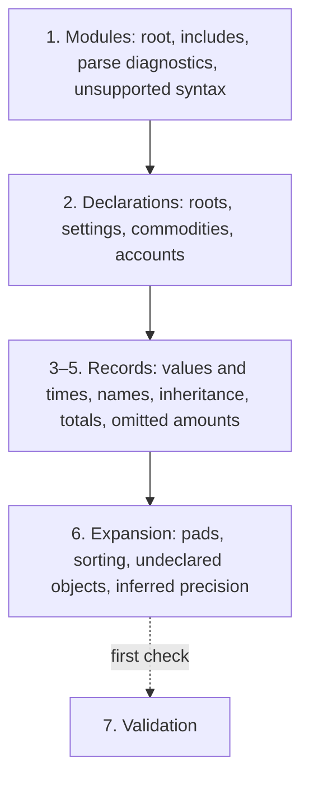

# Loading and normalization

Core never sees files. The platform parses each file into a **module** and loads it; initializing a **ledger** from a root module follows its `include`s, reads its settings and declarations, and normalizes every record into one derived model. This document covers the two models, loading and initialization, declarations and strict mode, the normalization steps, IDs and source positions.

## Features

| Feature | Status |
| --- | --- |
| Loading and initialization | `implemented` |
| Declarations and strict mode | `specified` |
| Duplicate declarations | `specified` |
| Normalization | `specified` |
| IDs | `specified` |
| Source positions | `implemented` |

## Concepts

A **module** is the parsed text of one file, identified by a **logical path** (see [modules.md](modules.md)). A **ledger** is one root module plus the modules it includes. Only the root module's settings and declarations take effect (see [modules.md](modules.md), "Declarations in included modules"). Initializing a ledger turns its modules into one derived model: the **ledger** object, called `Hueke` in the API.

**The two models**

| Model | Contents | Used for |
| --- | --- | --- |
| Raw model | What each file says, as written: only the fields written, such as a posting's own tags, an explicit `[time]` or `*`, an omitted amount left out, numbers and times as text, where comments and metadata stand. Nothing inherited, derived or generated. | Writing text back (see [../dsl/formatting.md](../dsl/formatting.md)) |
| Derived model | The result of normalization: inheritance, name resolution, expansion and derivation applied; generated records exist only here. | Queries, validation, views |

- The Raw model is plain immutable data. A module's Raw model holds its records in written order, the comments before its first record, the start offset of each line, and the parse diagnostics.
- Each derived record points back to its Raw record through `origin`. Rules that depend on what was written, such as `posting.pnl-effective`, look at `origin`, not at derived values.

**Ledger**

| Field | Meaning |
| --- | --- |
| `root` | The logical path of the root module. |
| `modules` | The logical paths of the modules of this ledger, in module order (see [modules.md](modules.md), "Modules and `include`"). |
| `data` | Every Raw model loaded, by logical path, unchanged. |
| `settings` | The ledger settings in effect (see [settings.md](settings.md)). |
| `roots` | The account roots, built-in and declared. |
| `accounts` | Every account, declared ones first, then those used without a declaration. |
| `commodities` | Every commodity, declared ones first, then those used without a declaration. |
| `transactions` | Every transaction, in order (see [transactions.md](transactions.md), "Order of transactions"), including generated ones. |
| `balances` | Every Balance assertion (see [balance.md](balance.md)). |

## Behavior

### Loading and initialization

Status: `implemented`

The platform reads each file, parses its text into a module, and loads it under its logical path. Then it initializes the ledger from one root.

| Stage | What it does |
| --- | --- |
| Load, once per module | Stores the module under its path. Nothing is interpreted or linked. Loading the same path again replaces the earlier module. |
| Initialize, once | Normalizes the ledger rooted at the given path into the derived model. |

- After initialization, nothing more can be loaded. When sources change, create a new ledger.
- A root that was never loaded is `module.missing`, and the ledger is empty: no records, no accounts, commodities or roots (not even the built-in ones), and `settings` at their defaults with the time zone UTC, whatever the creation options say.
- Modules are immutable, so several ledgers can share the same parsed modules, each with its own root, giving different views of the same files.
- The result depends only on the modules loaded, not on the order of loading.

### Declarations and strict mode

Status: `specified`

Accounts and commodities may be declared, or used without a declaration. Strict mode is turned on per kind with the ledger setting `strict`. Kinds not listed follow normal mode.

| Kind | Normal mode | Strict mode |
| --- | --- | --- |
| `account` | Any account can be used; an unknown root leaves it untyped (see [accounts.md](accounts.md), "Untyped accounts") | Only declared accounts can be used, and their root must be known |
| `commodity` | Any commodity can be used; its precision is inferred and `name.inferred-commodity` (info) is reported (see [commodities.md](commodities.md), "Inferred precision") | Must be declared first |

- Objects used without a declaration are created during normalization, after the declared ones, in the order of their first use in the source. The info diagnostics about them follow the same order.
- In strict mode, using an undeclared object is `strict.undeclared`, and a declared account with an unknown root is `strict.unknown-root`. Both are errors, but the ledger is computed exactly as in normal mode.
- The `strict` option given when creating the ledger turns on strict mode for every kind, whatever the ledger says.
- The kind `entity` may be listed; it has no effect until entities exist.

### Duplicate declarations

Status: `specified`

- When the root module declares a commodity, an account or an account root more than once, the first declaration is used and the later ones are ignored. Each later one is `declaration.duplicate` (error), naming the first one as `<module>:<line>`. This holds in every mode, strict or not.
- Declarations in included modules are never duplicates (see [modules.md](modules.md), "Declarations in included modules").
- Ledger settings follow their own rule (see [settings.md](settings.md), "Errors in settings").

### Normalization

Status: `specified`

Initialization turns the Raw models into the derived model in fixed steps. The result does not depend on the order records are written in, except where these documents say source order decides.

| Step | What happens |
| --- | --- |
| 1. Modules | Find the root, follow its `include`s (see [modules.md](modules.md)), collect parse diagnostics, and drop unsupported syntax (see [diagnostics.md](diagnostics.md), "Unsupported syntax"). |
| 2. Declarations | Read the root module's account roots (built-in and declared), then its ledger settings; then its commodities with their aliases, and its accounts. Declarations in included modules are not read (see [modules.md](modules.md)). [specified] |
| 3–5. Records | Read numbers, amounts and times now that the settings are known. Resolve names. Inherit times, status and tags. Turn prices and costs into totals. Fill in omitted amounts. |
| 6. Expansion | Expand `pad` Balances point by point (see [balance.md](balance.md)). Sort transactions. Create undeclared accounts and commodities, and infer precisions. |
| 7. Validation | Balancing, precision, item rules, `hard` Balance assertions. |

- Steps 1 to 6 run during initialization, because every other result depends on them.
- Step 7 only flags problems and never changes what is computed. It runs on the first call to `check`, and its result is kept.
- `check` is the only way to get diagnostics. It returns the parse diagnostics, those found during initialization, and step 7's, in that order.

### IDs

Status: `specified`

| Record | ID |
| --- | --- |
| Transaction with a `%anchor` | The anchor |
| Transaction without one | `~<n>`, numbered in source order from 1 |
| Posting with a `%anchor` | The anchor |
| Posting without one | `<transaction ID>.<n>`, numbered within the transaction from 1 |
| Transaction generated by `pad` | `~balance.<n>`, numbered in expansion order; its postings `~balance.<n>.<k>` |

- Generated IDs start with `~`, which an anchor cannot contain, so they never collide with anchors.
- A transaction dropped during normalization, such as one with `txn.amount-not-inferable`, still takes its number. A block that could not be parsed takes none.
- IDs without an anchor change when records are added before them. To keep an ID, write an anchor.

### Source positions

Status: `implemented`

- Every record parsed from text carries its span: start and end offsets in its module's text, end exclusive. A record's span covers its whole block, from its first line to the last line it owns.
- Offsets and columns count UTF-16 code units, as JS string indexes do. Lines and columns start at 1.
- Line and column are computed from the module on request; they are not stored on records.

## API

- `parse(path, text)` reads one file's text into a module (its Raw model, with parse diagnostics). The path is used only as the `source` of its diagnostics.
- `new Hueke(options)` creates an empty ledger. Options: `timezone`, the default time zone when the ledger sets none; `strict`, strict mode for every kind.
- `load(path, module)` stores a module. It throws after initialization.
- `init(root)` initializes the ledger from the root path. It throws when called twice, even when the root was missing.
- `check(ledger)` returns every diagnostic of the ledger (see "Normalization"). It throws before initialization.
- `position(module, offset)` returns the line and column of an offset, both from 1.
- `anchorKey(anchor)` returns the canonical text of an anchor, such as `lunch`; definitions and references of the same anchor give the same text.
- The functions for modules and paths, `referencedSources` and `resolvePath`, are described in [modules.md](modules.md).

## Examples

| Ledger | Result |
| --- | --- |
| Nothing loaded under the root path | `module.missing`; `transactions` is empty |
| `option strict account` and `account Spending:Food` | `strict.unknown-root` |
| `option strict account, commodity, entity`, postings on undeclared `Expenses:Other`, `Assets:Points` in undeclared `POINT` | `strict.undeclared` for each undeclared account and for `POINT`; none for declared accounts |
| `option strict commodity`, the same postings | One `strict.undeclared`, for `POINT` |
| The same postings, with strict mode given when creating the ledger | The same diagnostics as `option strict account, commodity, entity` |
| `account-root Bank asset`, then `account-root Bank liability` | `Bank` is an asset root; `declaration.duplicate` on the second declaration |
| `commodity NTD` with `precision 0`, then `commodity NTD` with `precision 2` | Precision 0; `declaration.duplicate` on the second declaration |
